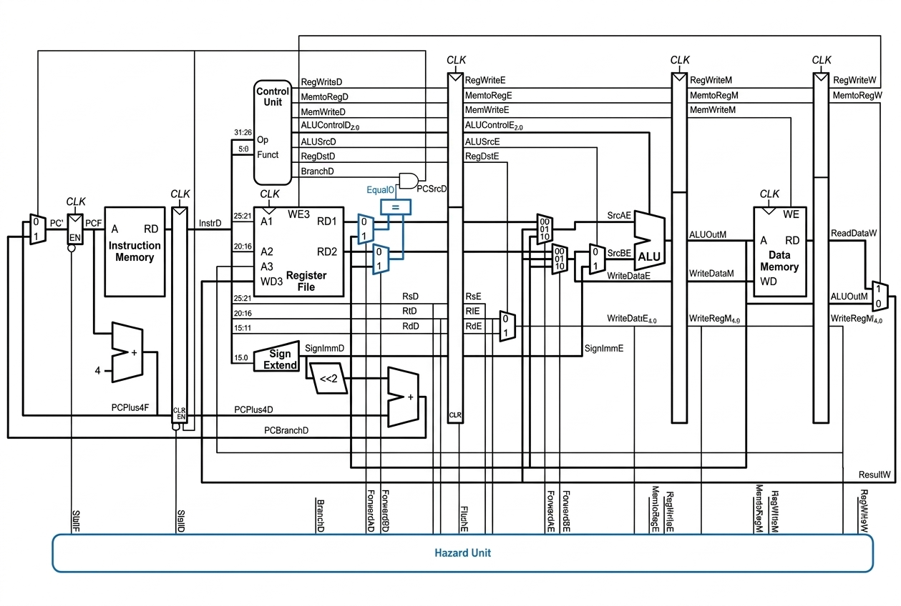

# Five-Stage Pipelined MIPS Processor - RTL Design & Functional Verification

A SystemVerilog processor project focused on pipelined datapath design, control,
and hazard handling. The RTL implements a subset of MIPS instructions in a
classic five-stage pipeline.

## Project goals

This project was built to understand how a processor pipeline works in RTL:
how instructions move between stages, how control signals guide the datapath,
and how dependencies between instructions are handled.

## Pipeline

| Stage | Purpose |
| --- | --- |
| IF — Instruction Fetch | Reads an instruction and updates the program counter. |
| ID — Instruction Decode | Decodes the instruction, reads registers, and resolves branches. |
| EX — Execute | Performs ALU operations and calculates memory addresses. |
| MEM — Memory Access | Reads from or writes to data memory. |
| WB — Write Back | Writes a result to the register file. |

## Pipeline and hazard diagram

The diagram shows the five pipeline stages and the paths used to handle
instruction dependencies.



## Hazard handling

The RTL includes:

- Forwarding from later pipeline stages to the execute stage.
- Forwarding to the decode stage for branch comparisons.
- Stalls and an execute-stage flush for certain load-use and branch
  dependencies.

These mechanisms are implemented in the hazard detection unit and datapath.
The diagram illustrates the design.

## Instruction subset

The decoder includes these instructions:

- R-type: `add`, `sub`, `and`, `or`, `slt`, and `jr`
- Memory and immediate: `lw`, `sw`, and `addi`
- Branches: `beq` and `bne`
- Jumps: `j` and `jal`

## How to run

### Requirements

- QuestaSim or ModelSim
- Java
- MARS, for assembling the example program and generating memory files

### Steps

1. Open the project root in QuestaSim or ModelSim.

2. Create the output folder if it does not exist:

   ```tcl
   file mkdir tb/Golden_Model
   ```

3. In `scripts/run_mars.do` and `scripts/run.do`, set `MARS_JAR` to the path
   of your MARS JAR file.

4. Generate the memory files for the example program:

   ```tcl
   do scripts/run_mars.do software/accumulation_sum.asm
   do scripts/handling_instr_file.do
   ```

5. Compile and run the processor:

   ```tcl
   do scripts/run.do
   ```

Run these commands from the project root. If you use another assembly program,
generate its memory files and make sure the assembly-file setting in
`scripts/run.do` points to that same program.

## Verification status

The repository contains directed assembly programs and simulator scripts for
running the design. The current testbench runs the processor for a selected
number of cycles, but automatically check the final register or
memory values against expected results.

## Repository layout

- `rtl/` — processor, datapath, control, and hazard logic
- `tb/` — testbench
- `software/` — assembly programs
- `scripts/` — simulator and MARS scripts